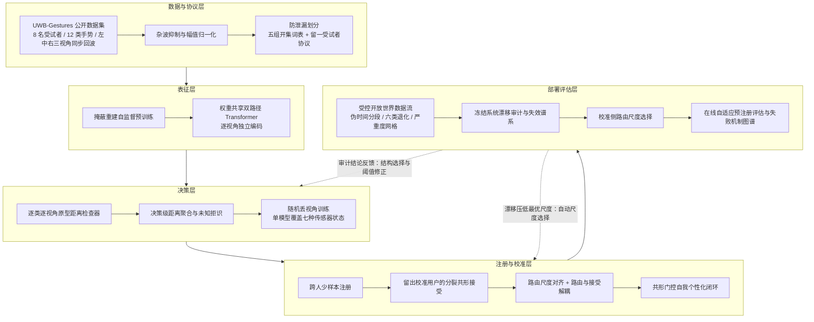

# 硕士学位论文开题报告

| 项目 | 内容 |
|---|---|
| 论文题目 | 面向开放世界部署的多视角超宽带雷达手势识别方法研究 |
| 学科专业 | 待填 |
| 研究方向 | 无线感知与模式识别 |
| 研究生 | 待填 |
| 指导教师 | 待填 |
| 开题日期 | 2026 年 7 月 |

---

## 一、选题背景与研究意义

### 1.1 研究背景

人机交互正从键盘、鼠标、触摸屏等接触式输入向语音、手势、眼动等自然交互形态演进。手势是人类最自然的表达方式之一，在智能家居、车载座舱、增强现实与无菌医疗环境中有明确的应用需求：驾驶员不移开视线即可调节车内设备，医生不接触任何器械即可翻阅影像资料。实现这类交互的前提是可靠的手势感知。

现有手势感知方案可分为三类。可穿戴方案精度高但要求用户佩戴设备，牺牲了交互的自然性；视觉方案数据丰富、研究成熟，但依赖光照条件，且采集原始影像带来隐私顾虑，难以部署在卧室、病房等隐私敏感场景；射频方案不需佩戴设备，不受光照影响，信号本身不含可辨认的影像信息，在隐私敏感场景具有不可替代的优势。

超宽带脉冲雷达是射频路线中颇具潜力的一支。它发射纳秒级窄脉冲，占用吉赫兹量级带宽，具备厘米级距离分辨率，能够精细刻画手部在视线方向的运动轨迹；发射功率极低，可隐藏于设备外壳之后工作。毫米波微手势识别已经落地消费电子产品，超宽带芯片也随室内定位应用在手机与智能家居设备中快速普及，为该方向提供了现实的硬件基础。

### 1.2 问题的提出

从实验室原型到真实部署之间存在一条长期被忽视的鸿沟。已有研究大多在四条隐含假设下评估算法：用户只做词表内的手势；传感器始终完好；测试数据与训练数据同分布；词表出厂后不再变化。这四条假设在真实部署中逐一失效，对应四个具体问题。

第一，未知手势误触发。真实环境中用户的绝大多数手部动作并非词表内指令，闭集分类器被迫将任意输入归入某一已知类别，产生大量误触发。系统必须具备开集识别能力。

第二，传感器失效。多传感器系统在部署周期内，个别传感器被遮挡、移位或损坏几乎必然发生。以常规方式训练的多视角模型在个别传感器失效时性能急剧退化，多传感器带来的不是冗余而是新的脆弱性来源。

第三，词表扩展。不同用户对指令有个性化需求，出厂词表无法覆盖。要求用户提供大量样本重新训练并不现实，系统必须支持少样本注册，同时不遗忘旧类、不丧失对真未知的拒识能力，并对"接受一个预测"给出可控的错误率保证。

第四，部署期分布漂移。传感器随时间退化，用户使用习惯变化，新注册手势的出现频率上升，词表外动作持续存在，这些因素叠加构成复合漂移。系统在复合漂移下哪些环节先失效、失效到什么程度、能否在线修复，此前缺乏量化证据；不回答这些问题，前三项能力的可靠性无从谈起。

### 1.3 研究意义

本课题的意义体现在方法与评估两个层面。方法层面，针对上述四个部署问题给出可落地的技术方案，包括多视角决策级聚合、随机丢视角训练、跨人少样本注册、共形拒识与路由尺度对齐，并在公开数据集上给出明确的量化收益。评估层面，构建面向真实部署的受控开放世界审计协议，将"系统在何种条件下失败、失败到什么程度、哪些修复路线已被证伪"作为与精度指标同等重要的交付物，为同类射频感知系统的可信部署评估提供可复用范式。

---

## 二、国内外研究现状及发展动态

### 2.1 雷达手势识别

雷达手势识别源于对微多普勒效应的利用，手部运动对回波的多普勒调制携带速度信息，配合距离维可刻画手势时空轨迹。Soli 项目在 60 GHz 毫米波雷达上系统展示了微手势识别的完整链路并推动该方向快速发展[1]。此后研究沿三条线索推进：输入表示从手工微多普勒谱图发展为距离-多普勒图、距离-慢时间图等保留更多原始结构的表示；模型从支持向量机、随机森林发展为卷积网络、循环网络与 Transformer；传感配置从单雷达发展为多雷达与雷达-视觉融合。在超宽带脉冲雷达方向，公开数据集 UWB-Gestures 提供了 8 名受试者、12 类手势、三台雷达同步采集的回波，为多视角研究提供了数据基础[2]。

已有工作绝大多数面向闭集分类，评估协议多采用随机切分，同一受试者甚至同一录制会话的样本同时出现在训练与测试集，系统性高估了跨用户部署性能。开集设定下的雷达手势识别相对稀少，代表性工作在单视角超宽带雷达上以逐类深度检查器输出异常分数实现未知拒识[3]。多视角信息在开集设定下的利用、多视角系统自身引入的传感器失效问题，以及跨受试者协议下的开集评估，尚缺乏系统研究。

### 2.2 开集识别

开集识别要求分类器在正确识别已知类的同时检测未知类，早期工作从支持向量机的开放空间风险出发[4]，深度学习时代形成三条路线：基于概率校准的方法以极值理论重新分配激活[5]；基于生成模型的方法合成未知样本参与训练；基于原型或距离的方法以样本到类别原型的距离作为异常证据[6]。近期研究指出闭集精度与开集能力高度相关，训练良好的闭集分类器配合合适的异常分数已是很强的基线[7]。原型距离路线的优势在于每个类别的接受区域独立建模，天然适配逐类阈值校准与后续的少样本注册。

### 2.3 少样本学习与类增量注册

少样本学习的主流范式是度量学习，原型网络将每类表示为支持样本特征均值并以最近原型分类[8]；类增量学习关注在不遗忘旧类的前提下持续加入新类，核心矛盾是稳定性与可塑性的平衡[9]。新手势注册问题位于两者交点：新类只有少量样本，且必须与充分训练的旧类共存，还要保持对真未知的拒识。三者叠加产生一个已有工作很少触及的困难，即少样本新类头与充分训练基类头的分数天然不在同一尺度上，直接比较会系统性偏向基类。

### 2.4 共形预测

共形预测是分布无关的不确定性量化框架，给定可交换的校准数据，可为任意黑盒模型构造以指定概率覆盖真实标签的预测集[10,11]。分裂共形预测将数据切分为训练与校准两部分，以校准集上非合规分数的分位数作为接受阈值，是实践中最常用的形式。其覆盖保证依赖校准分布与测试分布的可交换性；分布漂移下，自适应共形推断以在线阈值更新维持长期覆盖[12]。共形预测为本课题提供了"接受一个预测"的错误率语言。

### 2.5 测试时自适应与开放世界漂移

测试时自适应研究模型在测试期利用无标注测试流自我调整，代表方法包括最小化预测熵在线更新归一化层[13]、面向持续漂移的滑动平均教师与随机恢复[14]、冻结特征提取器仅在线调整类别模板[15]。这些方法在图像分类的合成腐蚀基准上取得进展，但普遍假设闭集词表。开放世界条件下漂移样本可能属于未知类，盲目自适应会把未知样本吸收进已知类，伪标签自训练的误差累积在漂移下被进一步放大[16]。已有方法能否迁移到"距离检查器加共形阈值"这类射频开集系统，此前没有证据。

### 2.6 现状小结与本课题切入点

综合来看，各方向均有成熟积累，但存在三处空白：多视角超宽带雷达的空间互补信息尚未被开集方法利用，多视角系统自身的传感器失效模式缺乏研究；少样本注册、开集拒识与覆盖保证三者的结合，特别是新旧类分数尺度失配问题，缺乏系统方案；面向真实传感系统的开放世界复合漂移评估协议缺失，自适应方法在此类系统上的有效性缺乏证据。本课题的三部分工作分别针对上述空白展开。

---

## 三、研究目标、主要研究内容与拟解决的关键问题

### 3.1 研究目标

在公开数据集 UWB-Gestures 上构建并系统评估一个面向开放世界部署的多视角超宽带雷达手势识别系统，使其同时具备四项能力：对词表外动作的可靠拒识、对任意单传感器失效的容错、对用户个人手势的少样本注册与带覆盖保证的接受判定、以及在复合分布漂移下可量化、可定位、可部分修复的行为。全部实验采用防泄漏协议，关键判据在实验前预注册，负结果如实报告。

### 3.2 主要研究内容

#### 内容一：多视角开集手势识别与传感器容错

研究逐视角独立编码与决策级聚合的多视角开集识别架构。以权重共享的双路径 Transformer 编码器逐视角提取特征，为每个已知类别在每个视角下训练基于原型距离的深度检查器，将逐视角距离在决策级聚合为异常分数实现未知拒识。针对多视角系统的传感器失效脆弱性，研究训练期随机丢视角策略，使单套模型覆盖全部传感器完好与失效状态，避免为每种失效组合单独训练模型。同时对架构级融合方案做系统消融，包括跨视角注意力、瓶颈中层融合与证据融合，明确多视角开集增益的真实来源，为多视角开集系统的结构选择提供依据。

#### 内容二：少样本新手势注册与校准开集拒识

研究用户侧新手势的少样本注册方法。新手势仅以少量跨人支持样本注册为正式类别，基类模型保持冻结以避免灾难性遗忘。以留出校准用户的分裂共形预测为接受判定提供覆盖保证，新类阈值由校准用户的注册类样本逐类校准。重点研究少样本新类头与充分训练基类头之间的分数尺度失配问题，引入路由尺度对新旧类别距离加以对齐，并将路由决策与接受判定解耦，使尺度校正不污染覆盖保证。进一步研究单一校准用户导致的阈值抽签现象及其多校准用户池化缓解方案，以及基于共形单元素预测集的自我个性化闭环，在无标注条件下收集用户个人样本并控制伪标签污染率。

#### 内容三：开放世界复合漂移审计与数据驱动尺度对齐

研究面向部署期的受控开放世界评估协议与漂移应对方法。以带伪时间结构的确定性数据流，将幅值衰减、加性噪声、距离轴平移、慢时间遮挡、视角掉落与处理域漂移六类退化按严重度网格施加于单个或全部视角，构建可复现的压力测试环境；对冻结系统完成系统性漂移审计，给出各退化族的失效谱系与统治性失败模式。在此基础上研究校准侧路由尺度选择方法，以部署时既有的校准数据自动替代人工设定的路由常数，实现免调参的尺度对齐。最后以预注册判据评估风险控制式在线自适应的有效性，对其失败模式给出机制归因，界定伪标签自采纳、用户确认通道与受损视角掩蔽三条修复路线各自的适用边界。

#### 内容四：属性先验驱动的极少样本注册（探索性内容）

针对注册能力在极少样本端的短板，研究以词表本身的属性结构作为先验的原型合成方法。手势词表可视为由若干运动属性轴张成的网格，若属性方向在冻结特征空间中线性可读，则未见组合类的原型可由已见单轴类的特征均值经属性算术合成，从而在单样本甚至零样本条件下完成注册。该内容按门槛推进：先在封闭比较中检验合成先验是否携带真实类别信息，再在含基类竞争与真未知拒识的完整注册协议中检验其净增益，并以无属性父类的对照类别排除"仅增加正样本数量"这一混淆解释。若门槛不通过，则作为诚实负结果并入内容二的讨论，不独立成章。

### 3.3 拟解决的关键问题

1. **多视角信息在开集设定下的正确使用方式。** 闭集分类中有效的架构级融合，在开集指标上是否同样有效，缺乏直接证据；同时多视角配置本身引入传感器失效这一新的失效面，如何在提升识别性能的同时不牺牲容错能力，是第一个关键问题。

2. **少样本新类头与基类头的分数尺度失配。** 少样本估计的原型偏且抖，其距离分布与充分训练的基类头不可比，路由阶段系统性偏向基类，导致新类被旧类吞噬。如何在不重训基类、不破坏跨头可比性的前提下完成尺度对齐，是第二个关键问题。

3. **校准数据稀缺下的阈值稳定性与覆盖保真。** 部署时可用于校准的标注用户极少，单一校准用户会使逐类阈值随该用户的个体特征大幅摆动，共形覆盖的名义保证与实际表现出现偏离。如何以有限校准数据获得稳定阈值，是第三个关键问题。

4. **复合漂移下的失效定位与可修复边界。** 部署期漂移是多因素叠加的，需要区分哪些退化由阈值层可修复、哪些属于表征层不可修复，并在实验前锁定判据以避免结论随结果调整。如何构建可控、可复现、可归因的评估协议，是第四个关键问题。

---

## 四、研究方法与技术路线

### 4.1 总体技术路线

本课题采用自下而上分层构建、自上而下反馈修正的技术路线。数据与协议层解决"用什么数据、按什么口径评估"；表征层解决"如何从多视角回波提取特征"；决策层解决"如何判已知与未知"；注册与校准层解决"如何扩展词表并给出错误率保证"；部署评估层解决"在漂移下如何量化失效与实施修正"。上层的审计结论反馈回下层的结构选择与阈值设计，形成闭环。总体路线如图 4-1 所示。



图 4-1 总体技术路线

> 说明：本图的排版版本见 `thesis/figs/fig_roadmap.pdf`，学位论文与开题答辩可直接复用。

### 4.2 分层方法设计

**数据与协议层。** 原始回波按慢时间与快时间组织为距离-慢时间矩阵，先做静态杂波抑制以去除墙体、家具等静止散射体的贡献，再做幅值归一化以消除跨视角、跨受试者的能量差异。评估协议同时使用两套划分：五组开集词表划分用于考察结论对已知类别集合选择的稳健性；留一受试者协议用于杜绝同人样本跨越训练与测试边界所导致的性能高估。开集与注册实验中，未知类别在训练期完全不可见。

**表征层。** 采用权重共享的双路径 Transformer 编码器，两条路径分别沿距离维与慢时间维建模，输出拼接为逐视角特征码。三个视角共享同一套编码器权重，既减少参数量，也保证不同视角的特征位于同一空间，为后续跨视角比较与属性算术提供前提。编码器先以掩蔽重建自监督目标预训练，再接入下游任务，以缓解标注样本有限的问题。

**决策层。** 每个已知类别在每个视角下训练一个独立的深度检查器，以样本特征到该类原型的距离作为异常证据。测试时先计算逐视角逐类距离，再在决策级做跨视角聚合得到最终异常分数，超过阈值判为未知，否则取距离最小的类别作为预测。训练期以一定概率随机置零部分视角的输入，使单套模型在任意视角子集下均可工作，从而以一次训练覆盖传感器完好与各种失效状态。融合位置的选择通过系统消融确定，对比逐视角编码加决策级聚合、跨视角注意力、瓶颈中层融合与证据融合四类方案在开集指标上的表现。

**注册与校准层。** 新手势以少量跨人支持样本估计原型并训练新类检查器，编码器与基类检查器全程冻结。接受判定采用分裂共形预测：留出若干校准用户，在其样本上计算非合规分数，取指定分位数作为逐类阈值，从而对接受行为提供覆盖保证。针对新旧类分数尺度失配，在路由阶段对新类距离施加标量尺度校正，使新旧类距离可比；该尺度只作用于路由，不进入接受判定所用的非合规分数，以保证覆盖不被校正污染。自我个性化闭环仅采纳共形预测集为单元素的样本作为伪标签，以控制污染率。

**部署评估层。** 构造带伪时间分段的确定性数据流，各段依次注入不同退化并保持随机种子固定，使整条流可逐字节复现。六类退化覆盖信号幅度、噪声、几何配准、时间遮挡、传感器可用性与信号处理域六个维度，每类退化按严重度网格施加于单视角或全部视角。审计以冻结系统为对象，逐族给出性能曲线与失效阈值。校准侧尺度选择在部署时以既有校准数据在候选尺度上做留出评估并自动选优，替代人工常数。在线自适应部分先写预注册文档锁定判据与分支条款，再运行实验，无论结果正负均按文档判决执行。

### 4.3 实验方案与评价指标

实验平台为公开数据集 UWB-Gestures，8 名受试者、12 类手势、三台脉冲雷达同步采集。开集实验在五组已知与未知类别划分上重复，注册实验在多组基类与注册类词表上重复，跨人实验采用留一受试者协议，全部结果报告多折均值与标准差。

评价指标按任务分层：闭集分类采用正确分类率；开集识别采用开集分类率与虚警率，并以开集分类率作为主指标，兼顾对已知类的正确分类与对未知类的拒识；注册任务采用新类精度、基类精度、未知拒识率及三者的调和均值，同时报告共形经验覆盖率与名义水平的偏差；漂移审计以各退化族严重度网格上的性能曲线与失效点为输出。

对比基线包括单视角开集方法、朴素多视角训练、各架构级融合变体、无尺度校正的注册流程、固定人工尺度常数，以及若干代表性测试时自适应方法。所有对比在同一编码器、同一划分、同一随机种子下进行。

### 4.4 可行性分析

**数据可行性。** 所用数据集公开可获取，包含多视角同步采集与受试者标识，满足开集划分、跨人协议与注册实验的全部需求；受控漂移流以确定性变换在该数据集上合成，无需额外采集。

**方法可行性。** 各技术要素均有成熟基础：Transformer 编码器与掩蔽重建预训练、原型距离开集检查器、分裂共形预测均有公开的理论与实现依据；本课题的创新集中在多视角组织方式、尺度对齐与评估协议层面，不依赖尚未验证的新组件。

**前期结果支撑。** 前期已完成的实验表明各层次目标可达：多视角决策级聚合在五组划分上将开集分类率由单视角基线的 86.74% 提升至 95.14%，跨受试者协议下增益扩大到 29.03 个百分点；随机丢视角训练使最差单视角失效状态由 43.35% 恢复到 81.30%，任一单传感器失效后整体保持在 90.8% 以上；少量跨人支持样本即可完成新手势注册，路由尺度校正将新类识别精度由 75.5% 提升到 87.3%，共形覆盖达到 90% 名义水平；受控流审计确认六类退化中五类可击穿冻结系统，校准侧尺度选择在五组词表上将新类精度提升 8.7 至 18.2 个百分点。上述结果表明技术路线整体成立，剩余工作以补全、复核与成文为主。

**条件可行性。** 实验代码库已具备完整的训练、评测、消融与结果留痕流程，单个编码器族的训练成本在数小时量级，现有计算资源可支撑剩余实验与复核性重跑。

---

## 五、论文特色与创新之处

1. **以部署问题而非模型结构组织研究主线。** 论文围绕未知手势误触发、传感器失效、词表扩展与部署期漂移四个真实部署问题逐层构建系统，各章共用同一冻结基座，形成一条从封闭开集识别到开放世界部署评估的完整链路，而非若干独立模块的拼接。

2. **给出多视角开集系统的反直觉结构性结论。** 通过对跨视角注意力、瓶颈融合、证据融合等架构级方案的系统消融，证明多视角开集增益来自逐视角独立编码与决策级聚合，架构级融合无益甚至有害。该结论与闭集任务中的普遍经验相反，为多视角开集系统的结构选择提供了直接证据。

3. **提出并解决少样本注册中的分数尺度失配问题。** 明确刻画少样本新类头与充分训练基类头的分数尺度差异及其对路由的系统性影响，提出路由尺度对齐与路由接受解耦方案，并进一步以校准侧自动尺度选择替代人工常数，实现免调参部署。

4. **构建可复现、可归因的开放世界审计范式并如实报告负结果。** 提出带伪时间结构与严重度网格的受控数据流协议，配合实验前预注册的判据与分支条款，产出失效谱系与失败机制图谱，包括若干被证伪的修复路线。将"知道系统在何种条件下失败以及哪些修复已被排除"作为正式研究成果，是本课题在方法论上的特色。

---

## 六、学位论文目录大纲

```
摘要
Abstract

第 1 章  绪论
  1.1  研究背景与意义
  1.2  国内外研究现状
       1.2.1  雷达手势识别
       1.2.2  开集识别
       1.2.3  少样本学习与类增量学习
       1.2.4  共形预测
       1.2.5  测试时自适应与开放世界漂移
       1.2.6  研究现状小结
  1.3  本文主要工作与创新点
  1.4  论文组织结构

第 2 章  相关理论与技术基础
  2.1  超宽带雷达感知原理
       2.1.1  脉冲雷达与信道冲激响应
       2.1.2  静态杂波抑制
       2.1.3  多视角采集与几何互补性
  2.2  深度特征提取
       2.2.1  Transformer 编码器与多头注意力
       2.2.2  自编码器与掩蔽重建预训练
  2.3  开集识别
       2.3.1  问题定义
       2.3.2  基于原型距离的深度检查器
       2.3.3  评价指标
  2.4  少样本学习与新类注册
  2.5  共形预测
       2.5.1  分裂共形预测与可交换覆盖
       2.5.2  校准数据的选取与逐类阈值
       2.5.3  分布漂移下的在线共形
  2.6  本章小结

第 3 章  多视角开集手势识别与传感器容错
  3.1  问题分析
       3.1.1  单视角的投影盲区
       3.1.2  朴素多视角训练的失效病态
  3.2  方法设计
       3.2.1  总体架构
       3.2.2  幅值归一化
       3.2.3  决策级聚合
       3.2.4  随机丢视角训练
  3.3  实验设置
  3.4  实验结果与分析
       3.4.1  多视角开集识别主结果
       3.4.2  架构级融合的系统性否定
       3.4.3  传感器容错
  3.5  本章小结

第 4 章  少样本新手势注册与校准开集拒识
  4.1  问题定义与挑战
  4.2  方法设计
       4.2.1  跨人少样本注册
       4.2.2  留出校准用户的分裂共形接受
       4.2.3  路由尺度校正与路由接受解耦
       4.2.4  基于共形门控的自我个性化
  4.3  实验结果与分析
       4.3.1  注册主结果与尺度失配
       4.3.2  单校准用户的尺度抽签与多用户池化
       4.3.3  自我个性化闭环
       4.3.4  属性先验驱动的极少样本注册
  4.4  本章小结

第 5 章  开放世界漂移审计与数据驱动尺度对齐
  5.1  受控开放世界数据流协议
       5.1.1  设计原则
       5.1.2  伪时间分段与退化族
       5.1.3  反馈预算与覆盖口径
  5.2  冻结系统的漂移审计
  5.3  校准侧路由尺度选择
       5.3.1  方法
       5.3.2  结果
  5.4  在线自适应的预注册评估与机制图谱
       5.4.1  系统与判据
       5.4.2  判决与机制图谱
       5.4.3  失败根因的族异质性与可达性上界
  5.5  本章小结

第 6 章  总结与展望
  6.1  工作总结
  6.2  研究展望

参考文献
致谢
攻读硕士学位期间取得的研究成果
```

预计正文篇幅 5 万字左右，插图 12 至 15 幅，表格 15 至 20 张。第 4 章 4.3.4 节视探索性内容的门槛判决结果决定保留或调整。

---

## 七、预期成果

1. 完成硕士学位论文一部，题为《面向开放世界部署的多视角超宽带雷达手势识别方法研究》。
2. 形成学术论文三篇：多视角开集手势识别与传感器容错、少样本新手势注册与共形拒识、开放世界漂移审计与尺度对齐，投向雷达感知或模式识别方向的期刊与会议。
3. 整理可复现的实验代码与实验记录，包括受控开放世界数据流生成脚本、预注册文档与全部实验结果留痕，支持第三方按同一协议复核。

---

## 八、研究工作计划与进度安排

| 阶段 | 时间 | 主要工作 |
|---|---|---|
| 一 | 2026.08 — 2026.09 | 探索性内容的门槛实验：属性先验注册的低样本臂与阴性对照，按预注册判据出判决；确定其独立成篇或并入注册章 |
| 二 | 2026.09 — 2026.10 | 复核性重跑与结果核对：关键表格重跑复现，统一各章数字口径，补配对显著性检验与标准差 |
| 三 | 2026.10 — 2026.12 | 学位论文正文扩充与图表定稿：补充理论基础章的推导与示意图，完成全部插图的期刊级重绘 |
| 四 | 2027.01 — 2027.02 | 学术论文投稿与返修；参考文献合并与著录格式统一 |
| 五 | 2027.03 — 2027.04 | 学位论文按学校模板排版，完成查重与预答辩，根据意见修改 |
| 六 | 2027.05 | 论文送审、评阅意见回复与答辩 |

具体时点按学院开题、送审与答辩日历调整。

---

## 九、已有工作基础与条件保障

**已完成的工作。** 三个层次的实验线均已完成主体部分。多视角开集识别与传感器容错部分：五组开集划分与留一受试者协议下的主结果、架构级融合的系统消融、七种传感器状态的容错评估已全部完成，论文稿件已成文。少样本注册部分：注册可行性、共形阈值校准、样本数曲线、校准用户轮换、路由尺度校正与自我个性化闭环已完成，论文正文主干已定稿。开放世界审计部分：受控数据流协议、冻结系统漂移审计、校准侧尺度选择、在线自适应的预注册评估与失败机制归因已完成，论文草稿已成形。学位论文六章初稿已建立并可正常编译，共 42 页，正文约 4 万字。探索性内容方面，属性方向在冻结特征空间的可读性与合成原型的初步验证已完成，在四类未见组合的封闭比较中合成原型达到 88.9% 的分类精度，随机水平为 25%，该结果仅表明先验携带真实类别信息，与完整注册协议下的指标不可直接比较，后续门槛实验将在含基类竞争与真未知拒识的完整协议中检验其净增益。

**尚需完成的工作。** 探索性内容的门槛判决；关键结果的复核性重跑与统计检验补充；学位论文的图表定稿、字数扩充、参考文献合并与学校模板适配；学术论文的投稿与返修。

**条件保障。** 数据集公开可获取；实验代码库已具备完整的训练、评测与结果留痕流程，实验记录文档累计四十余节，全部关键判据均有预注册文档与判决记录；计算资源可支撑剩余实验；指导教师在无线感知方向具备相应指导条件。

---

## 十、主要参考文献

[1] LIEN J, GILLIAN N, KARAGOZLER M E, et al. Soli: ubiquitous gesture sensing with millimeter wave radar[J]. ACM Transactions on Graphics, 2016, 35(4): 1-19.

[2] AHMED S, WANG D, PARK J, et al. UWB-gestures, a public dataset of dynamic hand gestures acquired using impulse radar sensors[J]. Scientific Data, 2021, 8(1): 102.

[3] EOM S, et al. Open-set gesture recognition with ultra-wideband impulse radar based on deep class inspectors[J]. 出版信息待补.

[4] SCHEIRER W J, ROCHA A, SAPKOTA A, et al. Toward open set recognition[J]. IEEE Transactions on Pattern Analysis and Machine Intelligence, 2013, 35(7): 1757-1772.

[5] BENDALE A, BOULT T E. Towards open set deep networks[C]//IEEE Conference on Computer Vision and Pattern Recognition, 2016: 1563-1572.

[6] GENG C, HUANG S J, CHEN S. Recent advances in open set recognition: a survey[J]. IEEE Transactions on Pattern Analysis and Machine Intelligence, 2021, 43(10): 3614-3631.

[7] VAZE S, HAN K, VEDALDI A, et al. Open-set recognition: a good closed-set classifier is all you need[C]//International Conference on Learning Representations, 2022.

[8] SNELL J, SWERSKY K, ZEMEL R. Prototypical networks for few-shot learning[C]//Advances in Neural Information Processing Systems, 2017, 30: 4077-4087.

[9] WANG Y, YAO Q, KWOK J T, et al. Generalizing from a few examples: a survey on few-shot learning[J]. ACM Computing Surveys, 2020, 53(3): 1-34.

[10] VOVK V, GAMMERMAN A, SHAFER G. Algorithmic learning in a random world[M]. New York: Springer, 2005.

[11] ANGELOPOULOS A N, BATES S. Conformal prediction: a gentle introduction[J]. Foundations and Trends in Machine Learning, 2023, 16(4): 494-591.

[12] GIBBS I, CANDES E. Adaptive conformal inference under distribution shift[C]//Advances in Neural Information Processing Systems, 2021, 34: 1660-1672.

[13] WANG D, SHELHAMER E, LIU S, et al. Tent: fully test-time adaptation by entropy minimization[C]//International Conference on Learning Representations, 2021.

[14] WANG Q, FINK O, VAN GOOL L, et al. Continual test-time domain adaptation[C]//IEEE/CVF Conference on Computer Vision and Pattern Recognition, 2022: 7201-7211.

[15] IWASAWA Y, MATSUO Y. Test-time classifier adjustment module for model-agnostic domain generalization[C]//Advances in Neural Information Processing Systems, 2021, 34: 2427-2440.

[16] YANG Z, ZHOU Q, LEI Z, et al. Test-time adaptation in open worlds: when distribution shifts meet novel classes[J]. 出处待核对.

[17] VASWANI A, SHAZEER N, PARMAR N, et al. Attention is all you need[C]//Advances in Neural Information Processing Systems, 2017, 30: 5998-6008.

[18] HE K, CHEN X, XIE S, et al. Masked autoencoders are scalable vision learners[C]//IEEE/CVF Conference on Computer Vision and Pattern Recognition, 2022: 16000-16009.

[19] HENDRYCKS D, GIMPEL K. A baseline for detecting misclassified and out-of-distribution examples in neural networks[C]//International Conference on Learning Representations, 2017.

[20] NEVEROVA N, WOLF C, TAYLOR G W, et al. ModDrop: adaptive multi-modal gesture recognition[J]. IEEE Transactions on Pattern Analysis and Machine Intelligence, 2016, 38(8): 1692-1706.

[21] NAGRANI A, YANG S, ARNAB A, et al. Attention bottlenecks for multimodal fusion[C]//Advances in Neural Information Processing Systems, 2021, 34: 14200-14213.

[22] HAN Z, ZHANG C, FU H, et al. Trusted multi-view classification[C]//International Conference on Learning Representations, 2021.

[23] BALTRUSAITIS T, AHUJA C, MORENCY L P. Multimodal machine learning: a survey and taxonomy[J]. IEEE Transactions on Pattern Analysis and Machine Intelligence, 2019, 41(2): 423-443.

[24] FANNJIANG C, BATES S, ANGELOPOULOS A N, et al. Conformal prediction under feedback covariate shift for biomolecular design[J]. Proceedings of the National Academy of Sciences, 2022, 119(43): e2204569119.
