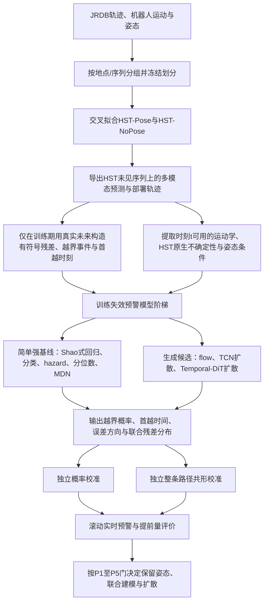

# 23 JRDB方向：姿态条件的概率残差失效预警——完整研究方案

**版本**：v1.0（2026-08-22）  
**状态**：研究设计稿，尚未执行实验，不代表已有结果  
**定位**：以路线A为主线；扩散模型必须实现并公平比较，但不是预定主模型  
**与22号文档的关系**：[`22_JRDB方向_行为条件残差生成失效预警_技术路线与计划.md`](22_JRDB方向_行为条件残差生成失效预警_技术路线与计划.md)保留为查新与外部审计记录；本文是吸收后续审计意见并修正统计、基线和工程边界后的独立执行版。

---

## 0. 一页结论

### 0.1 这项研究到底做什么

冻结一个现有的行人轨迹预测器HST。在机器人时刻$t$，HST根据已经观察到的历史轨迹、人体姿态和周围环境，输出未来12步的多模态轨迹分布；与此同时，另一个轻量失效预警器只使用$t$及以前的信息，加上HST刚刚输出的轨迹与不确定性，提前判断：

1. HST未来12步内发生大误差的概率；
2. 第一次超过误差阈值最可能发生在哪一步；
3. 错误主要沿机器人径向还是切向发展；
4. 整条真实未来轨迹应落在多宽的校准范围内；
5. 随着机器人继续观察，风险是在上升还是下降。

一句话概括：

> **不是再次预测“人会怎么走”，而是利用人的身体行为和HST自身输出，实时预测“HST接下来会怎样犯错”。**

### 0.2 与Shao 2023和HST的真正差别

- Shao et al. 2023已经冻结轨迹预测器，并回归未来各时刻的误差，因此“首次事前预测逐时刻轨迹误差”不能再作为创新。
- HST已经证明姿态有助于短历史行人的轨迹预测，并且自身输出多模态高斯混合分布，因此“姿态改善轨迹预测”和“轨迹预测带概率”也不能作为创新。
- 本文剩余的核心问题是：

> **对于一个已经使用姿态并输出多模态概率分布的HST，人体姿态的具体内容能否在HST经过校准的原生不确定性、运动学历史以及姿态可见性之外，继续提供未来实际失效的增量信息？**

### 0.3 预期贡献及其成立条件

| 候选贡献 | 成立条件 | 失败后处理 |
|---|---|---|
| **C1 核心科学贡献：姿态内容的增量失效预警** | detected-pose条件下，含姿态内容的M1稳定超过只含姿态质量的M0+，并超过重校准后的HST原生风险 | 删除“姿态预警”叙事；不得用oracle-pose挽救主结论 |
| **C2 方法贡献：联合有符号残差过程** | 联合模型在方向、首次越界、适当评分或匹配覆盖宽度上，稳定超过HST原生多模态残差、Shao式标量回归和简单概率模型 | 使用最简单的hazard/分位数/MDN；不把二维生成写入贡献句 |
| **C3 系统贡献：概率、提前量和整条路径覆盖分开校准** | 失效概率校准、首越时刻、滚动风险和整条路径同时覆盖均在独立数据上验证 | 降为经验结果；不得声称理论安全保证 |
| **C4 可选扩展：跨预测器迁移与共同/特有失效** | 在第二预测器上完成重训、只校准、零样本三档实验，并预先定义成功条件 | 从第一篇论文删除，不影响C1–C3 |

扩散模型不单独构成贡献。只有它在预注册指标和推理预算上超过简单模型，才升为主方法；否则保留为完整候选和负结果。

### 0.4 当前裁决

**Conditional Go。** 先执行第0周阻断检查和P0/P1最小实验。只有HST数据链可运行且C1有稳定增量，才进入完整交叉拟合、联合残差建模和扩散模型阶段。

### 0.5 技术路线鸟瞰



最容易混淆的地方是训练期和部署期：

- **训练期**可以在未来真实发生后计算HST到底错了多少，用这些错误训练预警器；但HST必须没有见过产生这些错误的序列。
- **部署期**没有未来真值。预警器只能看当前及过去、姿态以及HST此刻的预测，提前估计未来会不会错。
- **论文比较的核心**不是“复杂模型是否比一个弱模型强”，而是M1是否超过M0+和校准后的HST原生风险，以及复杂生成模型是否继续超过最强简单模型。

| 技术手段 | 在方案中的作用 | 为什么需要 |
|---|---|---|
| HST-Pose/HST-NoPose | 提供被诊断的轨迹预测器和同架构姿态对照 | 区分“姿态改善预测”与“姿态改善失效预警” |
| 分组交叉拟合 | 产生HST未见序列上的真实残差 | 避免用训练集内偏小残差训练预警器 |
| M0/M0+/M1 | 逐层加入运动学、姿态质量、姿态内容 | 隔离姿态内容的净增量，控制“看不清本来就更难” |
| hazard/分位数/MDN | 作为首越时刻、误差范围和多峰分布的简单强基线 | 防止把模型复杂度误当创新 |
| flow/TCN扩散/Temporal-DiT | 候选联合有符号残差生成器 | 检验复杂生成建模是否真的必要 |
| 概率校准 | 让70%风险对应接近70%的实际频率 | 支持可解释报警阈值 |
| 整条路径共形校准 | 检验12步未来的同时覆盖 | 避免把逐时刻90%覆盖误称为整条90%覆盖 |
| 序列/地点聚类推断 | 估计置信区间和稳定性 | 避免把大量相关窗口虚当成独立样本 |

---

## 1. 科学问题、假设与非目标

### 1.1 主科学问题RQ1

设HST已经获得历史轨迹、姿态、场景信息，并输出多个未来模式、模式概率和协方差。问题是：

> 人体姿态的具体构型、朝向及其时间变化，是否还包含HST自身没有正确表达的未来误差信息？

比较的不是简单的“有姿态/无姿态”，而是三层递进：

- **M0**：运动学、场景和HST原生输出；
- **M0+**：M0加姿态可得性、关键点置信度、遮挡比例，但不给关键点坐标和姿态内容；
- **M1**：M0+再加入真正的骨架、身体朝向、头部朝向、步态和姿态—运动不一致特征。

核心主张必须由$M1>M0+$支持。$M1>M0$不足以证明姿态内容有效，因为模型可能只利用了“能不能看清这个人”。

### 1.2 机制假设H1：短历史调制

姿态对失效预警的增量应在短历史行人上更大，因为只有1–2帧位置时速度估计不稳定，而单帧身体朝向和腿部构型可能已经携带运动信息。

但HST前人已经证明姿态有助于短历史轨迹预测，所以本文新的机制检验是：

> **控制HST原生不确定性后，姿态内容对“未来失效预警”的额外贡献是否仍随历史长度$L$增加而总体减弱。**

主检验使用历史长度与姿态分支的负交互趋势，而不是要求$L=1,2,3,5,9$五个点逐点严格单调。逐点单调仅作描述性结果。

### 1.3 方法问题RQ2

HST采用概率最高模式作为部署轨迹时，其未来误差是否存在简单标量模型无法表达的方向、多峰和跨时依赖？若存在，应使用什么复杂度的联合概率模型？

候选假设H2：经过HST原生多模态残差基线和简单概率模型控制后，联合残差模型仍能改善首次越界分布、方向预测和整条路径覆盖效率。

### 1.4 实时问题RQ3

预警器能否在误差真正越界之前提供可用提前量，同时维持可接受的误报率、概率可靠性和计算延迟？

### 1.5 本文明确不做什么

1. 不把姿态提高ADE/FDE当作创新；
2. 不把冻结预测器、自诊断、逐时刻误差回归当作创新；
3. 不识别“危险动作”“未知动作”或行为OOD；
4. 不把轨迹误差直接等同于碰撞或机器人安全事故；
5. 第一篇不接真实机器人闭环规划，不声称减少真实碰撞；
6. 不预设扩散必胜，也不因模型复杂而自动采用扩散；
7. 不使用真实未来选择HST最接近真值的候选模式。

---

## 2. 任务定义与实时数据流

### 2.1 时间轴

在机器人当前时刻$t$：

```text
t-L+1 ............. t | t+1 ...................... t+12
      已观测历史      |           尚未发生的未来
                      |
HST在t输出             -> 多个未来轨迹模式及概率
失效预警器在t输出       -> 未来残差概率、首越时刻、方向和风险
```

推理时所有输入必须来自$t$及以前。真实未来$Y_{t+1:t+12}$只在离线训练和评价时用于构造标签。

### 2.2 HST输出与部署轨迹

HST输出$M$个未来模式。第$m$个模式包含：

\[
\{\mu^{(m)}_{1:H},\Sigma^{(m)}_{1:H},w_m\},\qquad H=12
\]

主实验固定部署模式为：

\[
m^*=\arg\max_m w_m,\qquad \hat Y_{1:H}=\mu^{(m^*)}_{1:H}
\]

不得根据真实未来选择minADE/minFDE最优模式。minADE/minFDE只可作为轨迹预测器能力的补充指标，不能用于构造部署残差标签。

### 2.3 有符号残差定义

真实未来为$Y_{1:H}$，部署预测为$\hat Y_{1:H}$，定义：

\[
R_h=Y_h-\hat Y_h,\qquad h=1,\ldots,H
\]

为保证方向具有机器人意义，主坐标系冻结为时刻$t$的目标相对机器人坐标系：

- 径向$r$：从机器人指向行人的方向；
- 切向$q$：径向逆时针旋转90度；
- 所有未来位置先完成机器人运动补偿，再投影到$t$时刻固定的$r/q$轴；
- 不随未来机器人姿态逐步重定义坐标轴，避免标签自身旋转。

于是：

\[
R_h=(R_{h,r},R_{h,q})\in\mathbb R^2
\]

标量误差仍保留为强基线：

\[
e_h=\lVert R_h\rVert_2
\]

### 2.4 失效事件与首越时刻

给定阈值$d^*$：

\[
F=\mathbb I\left(\max_{1\le h\le H}\lVert R_h\rVert_2>d^*\right)
\]

首次越界时刻：

\[
\tau=\min\{h:\lVert R_h\rVert_2>d^*\}
\]

若12步内始终没有越界，则$\tau$作为右删失样本处理，不能删除。

### 2.5 阈值双轨

第0阶段先盲审事件率，再冻结一个主阈值；官方测试集不得参与选择。

1. **绝对阈值轨**：$d^*\in\{0.5,1.0\}$米，用于应用可解释性和敏感性分析；
2. **相对阈值轨**：先在开发数据上定义整条轨迹最大标准化误差

\[
E_i=\max_h\frac{\lVert R_{i,h}\rVert_2}{s_h}
\]

其中$s_h$仅由开发数据估计，再取$E_i$的预注册高分位作为事件阈值。不得把“逐horizon的90分位”误称为整条轨迹10%事件率。

所有AUPRC必须同时报告正类率；若正类不是稀有事件，还要报告AUROC、Brier和相对随机基线的AP提升。

### 2.6 最终实时输出

每个时刻$t$、每个行人输出：

1. $P(F=1\mid\mathcal I_t)$：未来12步内越界概率；
2. $P(\tau=h\mid\mathcal I_t)$：首次越界时间分布；
3. $P(R_{h,r}>0)$、$P(R_{h,q}>0)$及方向置信度；
4. $K$条联合残差样本或其参数化分布；
5. 经校准的整条未来路径范围；
6. 滚动风险曲线$p_t,p_{t+1},\ldots$及风险增量$\Delta p_t$。

这里$\mathcal I_t$只包含$t$及以前可得信息。

---

## 3. 数据集、模态与数据契约

### 3.1 主数据集

| 数据 | 用途 | 当前边界 |
|---|---|---|
| **JRDB/JRDB-Traj** | 机器人第一视角轨迹、机器人运动、未来12步评价 | 主数据；先核实公开测试标注包是否包含构造逐步残差所需的完整坐标和ID |
| **HST官方JRDB预处理数据** | 机器人运动补偿、检测轨迹、33个3D关键点、头部朝向及HST输入格式 | detected-pose主路线；必须先确认能否获取和复现 |
| **JRDB-Pose** | 17个2D关键点、可见性、track ID | 用于姿态质量、遮挡分析和可选oracle上界；不能直接冒充HST的33点3D输入 |
| **JRDB-Pose3D（2026）** | 多人3D姿态和形状 | 可选oracle/接口替代；第0周核实关节映射、时间覆盖和track对齐后再决定 |
| **JTA** | 合成姿态与轨迹外部验证 | 仅在JRDB主结果成立且时间允许时使用，不替代真实机器人视角主结果 |

JRDB官方当前说明整个数据集有54条视频序列，并已发布测试集标注；计划仍须登录下载后逐文件核实。测试标注公开不等于可以在开发阶段反复查看。

### 3.2 姿态结果的两条口径

1. **Detected-pose主结果**：使用真实系统能够得到的姿态检测结果及其置信度、缺失掩码；论文主结论必须在这条线上成立。
2. **Oracle-pose上界**：使用人工标注或JRDB-Pose3D映射后的高质量姿态，回答“姿态信号理论上是否存在”。只在oracle成立不能支撑部署主张。

### 3.3 历史长度

按有效位置历史长度分层：

\[
L\in\{1,2,3,5,9\}
\]

- $L=1$表示首次检测，只能获得当前位置和当前姿态；
- 不允许为了方便组成固定窗口而过滤短历史行人；
- 位置信息、姿态信息分别记录有效长度，不能默认两者同步可得；
- 同时记录目标是否新出现、距机器人距离、遮挡比例和跟踪质量。

### 3.4 每个样本的数据契约

每个预测时刻保存一条不可变记录，至少包含：

```text
scene_id, location_id, track_id, timestamp
history_length_position, history_length_pose
past_position, robot_ego_motion
pose_content, pose_visibility, pose_confidence, pose_missing_mask
crowd_density, target_range, occlusion_level
hst_variant, hst_checkpoint_id
hst_mode_means, hst_mode_covariances, hst_mode_weights
deployed_mode_id, deployed_trajectory
ground_truth_future
signed_residual_rq, residual_norm
failure_label_absolute, failure_label_relative
first_crossing_time, censoring_flag
split_role, fold_id
```

生成后记录数据版本、代码版本、特征时间戳范围和哈希。训练代码不得临时重新读取原始未来文件生成输入特征。

---

## 4. 被诊断对象：HST双变体

### 4.1 为什么选择HST

HST是JRDB原生的多人轨迹预测框架，输入历史位置、头部朝向和3D骨架关键点，输出多模态高斯混合轨迹。它既使用姿态又报告原生不确定性，因此是检验“姿态能否暴露预测器未意识到的错误”的高难度对象。

### 4.2 同架构双变体

| 变体 | 输入 | 目的 |
|---|---|---|
| **HST-NoPose** | 历史位置、交互、机器人运动及相同非姿态上下文 | 测量姿态对轨迹预测器本身的作用 |
| **HST-Pose** | HST-NoPose全部输入 + HST官方姿态/头朝向 | 主被诊断对象，检验预测器已经消费姿态后的剩余预警增量 |

两者必须保持相同：

- 数据划分；
- 预测步长与采样率；
- Transformer层数、隐藏维度和多模态数；
- 优化器、训练轮数、早停规则和随机种子集合；
- 检测轨迹、机器人运动补偿和场景输入。

Social-Transmotion只作为可选跨架构验证，不能替代同架构姿态消融。

### 4.3 主实验优先级

算力不足时按以下顺序缩减：

1. 先完成HST-Pose主线及M0/M0+/M1；
2. 再完成HST-NoPose同架构对照；
3. 最后才加入Social-Transmotion或其他预测器。

不得为了保留跨预测器实验而牺牲HST-Pose最难一格的统计完整性。

---

## 5. 失效预警器的输入与编码

### 5.1 M0：无姿态内容

M0包含：

1. 历史位置、位移、速度可估计标志和历史长度$L$；
2. 机器人自身平移、旋转和速度；
3. 人群密度、最近邻距离、交互图统计；
4. HST部署轨迹；
5. HST模式权重、最大模式概率、熵；
6. HST逐步协方差、候选模式分散度和曲率分散度；
7. 跟踪置信度、目标距离和非姿态遮挡信息。

### 5.2 M0+：只加入姿态可得性，不给姿态内容

M0+在M0基础上加入：

- 每帧有效关键点比例；
- 平均关键点置信度；
- 可见/遮挡/不可见比例；
- 姿态有效历史长度；
- 是否首次检测到姿态；
- 姿态检测是否完全缺失；
- 图像中人体尺度或检测框面积。

M0+用于控制“看不清的人本来就难预测”这一混淆。

### 5.3 M1：加入姿态内容

M1在M0+上加入：

1. 以髋部/躯干中心平移归一化的关键点；
2. 按躯干尺度归一化的骨架形状；
3. 身体朝向、头部朝向；
4. 头/身体朝向与历史运动方向的夹角；
5. 左右腿相对构型、步幅、步态相位的可学习表示；
6. 姿态变化速度；
7. 姿态与HST部署轨迹方向的不一致程度；
8. 所有关键点的置信度和缺失掩码。

不把人工动作类别作为模型输入，避免把未来标注或事后动作标签混入实时条件。

### 5.4 编码器

- 运动学分支：2–3层小型时序Transformer或TCN；
- 姿态分支：轻量骨架图卷积或关键点token Transformer，带置信度和缺失mask；
- HST分布分支：模式级set encoder，保持模式置换不变性；
- 场景分支：MLP或小型交互图编码器；
- 融合：cross-attention或门控融合，输出统一条件token；
- 条件随机遮蔽：训练时随机遮蔽姿态内容、运动历史或HST内部量，使模型在模态缺失时仍可运行，同时支持消融。

第一轮P1不需要上复杂姿态编码器。先用简洁、参数量匹配的TCN/Transformer验证M1是否超过M0+；信号存在后再优化结构。

---

## 6. 必须先跑的原生基线

### 6.1 基线0a：HST原生不确定性标量

直接使用：

- $1-\max_m w_m$；
- 模式熵；
- 部署模式协方差；
- 候选终点分散度；
- 候选整条轨迹分散度；
- 模式曲率和方向分歧。

这些量分别直接预测失效事件，并在独立数据上做概率重校准。

### 6.2 基线0b：HST原生多模态残差分布

这是联合残差模型最重要的免费基线。相对部署模式$m^*$，将HST其他模式映射到残差空间：

\[
\tilde R^{(m)}_{1:H}=\mu^{(m)}_{1:H}-\mu^{(m^*)}_{1:H}
\]

保留$w_m$和$\Sigma^{(m)}$，或直接从HST的GMM采样$\tilde Y$后计算：

\[
\tilde R=\tilde Y-\hat Y^{(m^*)}
\]

由此直接估计越界概率、首越时刻和误差方向。若新联合模型不能超过此基线，就不能声称新模型发现了HST尚未表达的多峰残差结构。

需要明确：该基线是HST“认为真实未来可能在哪里”的分布映射，并不等于真实误差分布。它是否校准，必须由独立数据检验。

### 6.3 基线0c：重校准后的HST事件概率

从0a/0b得到原始失效概率后，在独立概率校准数据上比较：

- Platt scaling；
- isotonic regression；
- 必要时对模式logit做温度缩放。

选择方法只看Brier、可靠性和校准误差，不能用最终测试集选择。

核心P1比较的是M1与**重校准后的**HST原生风险，不是未经处理的方差或熵。

---

## 7. 预警模型阶梯

所有模型使用完全相同的数据、输入版本、残差标签、划分和评价代码。

### 7.1 最近邻与简单基线

1. HST原生0a/0b/0c；
2. Shao 2023式轻量逐时刻标量误差回归；
3. Logistic/MLP整段越界分类器；
4. 逐horizon异方差高斯回归；
5. 分位数回归；
6. 离散时间hazard模型，直接预测首越时刻并处理右删失；
7. 零均值、按horizon定标的高斯残差。

Shao表III显示其设置中标量距离回归优于x/y分量回归。因此标量路线必须是强基线；只有方向和联合时间信息带来额外价值时，二维残差才保留。

### 7.2 中等复杂度联合模型

8. 5分量或数据驱动分量数的MDN；
9. 低秩多元高斯/高斯copula；
10. conditional flow matching；
11. TCN/U-Net条件扩散，用于隔离“扩散目标”与“Transformer结构”的贡献。

### 7.3 Temporal-DiT条件残差扩散

#### 生成对象

\[
R_{1:H}\in\mathbb R^{12\times2}
\]

不是生成行人轨迹或动作标签，而是生成相对HST部署轨迹的未来有符号误差过程。

#### 条件

\[
c=\operatorname{Enc}(X_{\text{past}},C_{\text{scene}},\hat Y,
\Phi_{\text{HST}},Q_{\text{pose}},B_{\text{pose}})
\]

其中$Q_{\text{pose}}$是姿态质量，$B_{\text{pose}}$是姿态内容。M0、M0+、M1通过遮蔽对应条件得到，尽量共享主干参数和训练预算。

#### 前向加噪

\[
R_t=\sqrt{\bar\alpha_t}R+
\sqrt{1-\bar\alpha_t}\epsilon,
\qquad \epsilon\sim\mathcal N(0,I)
\]

#### 去噪网络初始规格

- 4–6层Temporal-DiT；
- hidden size 128；
- 4个注意力头；
- AdaLN或cross-attention注入条件；
- 余弦噪声日程；
- $\epsilon$-prediction作为起点；
- EMA模型权重；
- 参数量目标小于10M；
- 条件遮蔽训练，允许无姿态推理；
- 不使用未来动作标签或未来可见性。

#### 推理

- DDIM 10步和20步两档；
- 每个样本生成$K\in\{20,50,100\}$条残差；
- 人群维度和样本维度尽量批处理；
- 从样本直接计算越界概率、首越时刻和方向分布；
- 先做采样数收敛分析，再冻结$K$。

扩散必须同时与MDN、flow、TCN扩散和HST原生0b比较。模型复杂不是采用理由。

---

## 8. 概率校准与共形覆盖必须分开

### 8.1 概率校准

目标：当模型报告70%越界风险时，类似样本中实际越界频率应接近70%。

方法：Platt、isotonic或温度缩放。评价：

- Brier score；
- reliability diagram；
- ECE仅作补充，因为它依赖分箱；
- log loss仅用于具有明确事件概率的模型，不拿扩散的不可得精确似然与flow比较。

### 8.2 整条路径的共形校准

目标：校准整条12步残差路径的预测范围，而不是校准一个0.7概率。

基础非一致性分数：

\[
s_i=\max_{1\le h\le H}
\frac{\lVert R_{i,h}-\hat\mu_{i,h}\rVert_2}
{\hat\sigma_{i,h}+\epsilon}
\]

或采用CAFHT式适应异质时间序列的同时覆盖构造。必须报告：

- 整条路径同时覆盖率；
- 平均带宽/面积；
- 覆盖—宽度曲线；
- 短历史、遮挡、拥挤和距离分层覆盖；
- track级经验版本与序列/地点分块稳健版本的差异。

### 8.3 保证边界

同一视频中的行人和滑动窗口高度相关，不能把所有track简单当作完全独立可交换样本。因此：

1. track级split CP只称“轨迹边际经验覆盖”；
2. 另做按序列/地点分块的保守变体；
3. 若校准独立组数不足以支持90%有限样本分位，则明确报告“保证不可识别/区间退化”，不得悄悄改成窗口级$n$；
4. 不声称分层条件覆盖的有限样本理论保证，除非所用方法和假设确实支持。

---

## 9. 数据划分、交叉拟合与统计单位

### 9.1 分组原则

- 第一分组键：地点/录制session；
- 第二分组键：视频序列；
- 同一track及其所有滑动窗口必须在同一划分；
- 同一地点的相邻录制优先放在同一组，防止背景和路线泄漏；
- 官方测试集在架构、阈值、概率校准和共形规则冻结后只评一次。

### 9.2 推荐的两阶段协议

#### 协议A：开发和模型比较

在官方训练序列内做按地点/序列分组的$K=4$交叉拟合：

1. 每次用3折训练HST；
2. 只在未见的第4折导出HST模式、概率和真实残差；
3. 轮换得到完整out-of-fold残差数据集；
4. 预警器的超参数和M0/M0+/M1比较采用嵌套的分组交叉验证；
5. 模型选择完成后冻结结构，不再根据官方测试集修改。

#### 协议B：最终校准与测试

在官方训练部分预先留出足够的校准序列/地点，确保HST和预警器均未在这些组上训练；其余组用于交叉拟合与模型训练。具体数量在第0阶段根据地点数、样本量和90%分位可识别性一次性冻结。

最终流程：

1. 训练冻结的部署HST；
2. 使用OOF残差训练预警器；
3. 用独立组选择报警阈值和概率校准器；
4. 用独立共形校准数据确定轨迹管尺度；
5. 在官方测试集一次性报告最终结果。

### 9.3 交叉拟合分布错配

OOF预警器看到的是用约$3/4$数据训练的HST，而最终部署HST可能使用更多数据，二者误差分布可能不同。必须二选一或同时报告：

1. 部署由fold模型构成的固定集成，使训练和部署对象一致；
2. 使用全量/更多数据HST，但在独立序列上量化fold-HST与部署HST的残差尺度差异，并重新做概率与轨迹管校准。

不得默认这种错配不存在。

### 9.4 统计单位

- 指标可在窗口/track层计算；
- 置信区间和显著性推断必须按序列或地点聚类重采样；
- 不使用普通窗口级或普通track级bootstrap声称$n$很大；
- 主比较采用配对差值：同一测试场景、同一track、同一时刻比较M1与M0+；
- 同时报告各序列效应分布，避免总体结果由单个拥挤场景支配。

---

## 10. 因果性、泄漏与混淆审计P0

任何P1结果发表前必须通过：

1. 时间戳断言：每个输入字段的最大时间戳不超过$t$；
2. 因果mask单元测试：遮蔽未来后输出不变；
3. 特征生成代码走查：动作、可见性、轨迹平滑不得使用$t$之后帧；
4. 阳性对照：故意注入未来位置/未来动作，审计必须检测出来；
5. 未来打乱：未来标签打乱后性能退回随机水平；
6. 姿态内容阴性对照：在相同场景、相近历史长度和相近姿态质量的行人间置换完整姿态历史，M1相对M0+增量应消失；
7. 姿态可得性对照：M0+单独报告，防止M1只利用缺失模式；
8. 重复窗口审计：同一track相邻窗口不得跨划分；
9. HST训练集审计：预警器训练标签必须来自HST未见序列上的残差；
10. 坐标与机器人运动审计：不得把未来里程计或未来坐标变换混入$t$时刻条件。

任一项失败，停止P1，先修数据链。

---

## 11. 实验矩阵

### E0：第0周阻断检查

回答五个问题：

1. JRDB、JRDB-Traj、JRDB-Pose、测试标注和track ID能否完整取得并对齐；
2. HST官方预处理数据是否可下载，还是必须重新跑3D姿态检测；
3. HST checkpoint能否复现官方数量级结果；
4. HST在现有硬件/WSL2或Linux环境上能否训练，一次耗时和显存是多少；
5. 33点3D HST姿态、17点2D JRDB-Pose和JRDB-Pose3D之间如何映射。

输出：可访问性清单、最小样本可视化、一次前向时间、一次短训练估时、数据字段对齐报告。

### E1：样本与事件率审计

按$L=1,2,3,5,9$统计：

- track数、窗口数、独立序列/地点数；
- detected-pose可得率和关键点质量；
- 0.5m、1.0m和相对事件的正类率；
- HST-Pose与NoPose的max-probability ADE/FDE，而不是只看minADE/minFDE；
- 新出现行人、遮挡和拥挤样本量。

该阶段可以冻结一次主阈值、主历史分层和最小效应量，但必须留痕，且不得查看官方测试结果。

### E2：HST原生风险基线

比较0a、0b、0c：

- 原生熵/方差；
- HST多模态映射得到的免费残差分布；
- 重校准后的事件概率。

这一步建立真正的“司机自己知道多少”的上限基线。

### E3：姿态增量生死实验P1

同一HST架构形成四格背景实验：

| 被诊断预测器 | M0/M0+预警器 | M1预警器 |
|---|---|---|
| HST-NoPose | 对照 | 姿态是否能补预测器未见信息 |
| HST-Pose | **主对照** | **最难一格，也是核心主结果** |

核心比较：HST-Pose下$M1$对$M0+$，并同时对比重校准HST原生风险0c。

建议预注册主判据：

- 主指标：冻结阈值下12步内越界事件的AUPRC；
- 最小实用效应：$\Delta\mathrm{AUPRC}\ge0.03$绝对值（E1后、测试前只允许冻结一次）；
- 序列/地点聚类bootstrap的95%置信区间下界大于0；
- Brier不恶化，可靠性不能明显变差；
- detected-pose必须成立；
- 姿态置换后增量消失；
- 历史长度与姿态增量的交互趋势为负，作为机制支持。

若M1不能超过M0+或0c，C1失败，停止姿态主叙事。不要为了救结果立即扩大模型搜索。

### E4：首越时刻与简单模型P2a

比较Shao式回归、分类器、hazard、分位数、高斯和MDN：

- 越界AUPRC/Brier；
- Integrated Brier Score；
- 时间依赖AUPRC；
- 首越时刻分布；
- 固定误报率下的提前时间；
- 计算延迟。

### E5：联合有符号残差必要性P2b

先诊断真实残差在控制HST原生模式后是否仍存在：

- 方向相关；
- 跨horizon相关；
- 条件多峰；
- 突变与累积两类发展模式。

然后比较标量、低秩高斯、MDN、flow、TCN扩散和Temporal-DiT。二维联合路线至少应在以下四项中的三项具有稳定优势，才进入主方法：

1. Energy Score/Variogram Score；
2. 匹配覆盖率下的轨迹管宽度；
3. 首越时刻生存指标；
4. 错误方向指标。

### E6：扩散必要性P3

Temporal-DiT只有同时满足下列条件才升主模型：

1. E5确认简单分布无法表达的残差结构存在；
2. 超过HST原生0b和最强非扩散模型；
3. 多个随机种子和主要序列上结果稳定；
4. 采样数增加后指标收敛；
5. 实际硬件上满足冻结的实时预算。

初始效率门建议为：对20名行人的一帧场景，预警器新增延迟不超过100ms；同时报告1/10/20/50人、DDIM 10/20步和$K=20/50/100$的延迟。第0周根据硬件实测可在看结果前调整一次。

若扩散不通过，使用hazard、分位数或MDN作为主模型，扩散进入附录或形成“复杂生成模型不必要”的负结论。

### E7：校准P4

分别完成：

1. 事件概率校准；
2. 首越时刻概率校准；
3. 整条路径同时覆盖校准；
4. 短历史、遮挡、距离和人群密度分层覆盖审计。

不把概率可靠性和轨迹覆盖率混成一个指标。

### E8：实时预警和提前量P5

逐帧滚动运行HST和预警器，构造风险曲线。按失效episode而不是窗口计数：

- 固定误报率下的中位提前步数/秒；
- 每条track误报次数；
- 每分钟误报次数；
- 风险上升斜率作为触发条件时的收益；
- 首次报警到实际首越的时间分布；
- 持续高风险但最终未越界的比例。

### E9：可选跨预测器实验P6

只有C1–C3完成后才加入第二预测器，分三档：

1. 换预测器后重训预警器；
2. 不重训预警器，只重做概率/共形校准；
3. 零样本迁移。

内部输入只能使用跨架构可比的量，如模式熵、候选散布、协方差、曲率和运动学，不直接使用HST专有encoder特征。跨预测器不作为第一篇必做贡献。

---

## 12. 评价指标

| 目标 | 主指标 | 补充指标/注意事项 |
|---|---|---|
| 越界事件 | AUPRC、Brier | 同时报告正类率、AUROC、可靠性曲线和AP相对随机基线提升 |
| 姿态增量 | 配对$\Delta$AUPRC、$\Delta$Brier | 按序列/地点聚类bootstrap，不按窗口当独立$n$ |
| 首越时刻 | Integrated Brier Score、时间依赖AUPRC | 处理右删失；不只在已经越界的样本上算MAE |
| 联合残差分布 | Energy Score、Variogram Score | 不使用扩散不可得的精确NLL做跨家族主比较 |
| 方向 | 径向/切向符号准确率、角度误差 | 只在误差幅值达到预定最低值时解释方向，避免零误差方向无意义 |
| 轨迹覆盖 | 整条同时覆盖率、平均带宽/面积 | 必须匹配覆盖率比较宽度；报告分块稳健版本 |
| 实时预警 | 固定误报率下的中位提前秒数 | 同时报每track/每分钟误报和漏报 |
| 效率 | 参数量、单场景延迟、吞吐 | 报告人数、采样步数、采样条数和硬件 |
| 轨迹预测器本身 | max-prob ADE/FDE、NLL、minADE/minFDE | 残差标签基于max-prob/部署轨迹，不能基于oracle best-of-$M$ |

---

## 13. 门与停止规则

| 门 | 通过条件 | 不通过时 |
|---|---|---|
| **P-1 工程阻断门** | 数据、测试标注、姿态接口、checkpoint和训练成本均有可复现证据 | 更换预测器/姿态接口或停止，不进入大规模训练 |
| **P0 因果与泄漏门** | §10全部检查通过 | 修数据链；任何性能结果无效 |
| **P1 姿态内容增量门** | HST-Pose下M1超过M0+与校准0c；达到冻结效应量；cluster CI下界>0；detected-pose成立 | 删除C1；原则上停止扩散扩张，重新评估论文价值 |
| **P2 联合残差必要性门** | 二维联合模型在E5四项中至少三项稳定优于标量/原生基线 | 使用标量hazard/分位数；删除二维生成贡献 |
| **P3 扩散必要性门** | 复杂结构存在，扩散超过非扩散强基线并满足延迟 | 扩散降附录，最简单过门模型为主 |
| **P4 校准门** | 概率可靠性改善；轨迹管在目标覆盖附近且宽度有限；困难分层无灾难性漏覆盖 | 只报未校准/经验结果，不声称可靠保证 |
| **P5 实时价值门** | 在冻结误报率下有正的、稳定的提前量且计算满足预算 | 只能称离线误差估计，不能称实用实时预警 |
| **P6 跨预测器门（可选）** | 至少重训档稳定成立；只校准/零样本分别如实报告 | 删除C4，不影响主线 |

---

## 14. 分阶段具体执行步骤

### 第0周：可行性阻断检查

1. 下载并核对JRDB各数据包；
2. 验证官方测试标注中轨迹和ID字段；
3. 跑通HST官方checkpoint一次前向；
4. 抽取一个序列，可视化历史轨迹、HST多模式、部署模式、真值和残差；
5. 运行短训练，估算完整训练时间；
6. 输出姿态接口映射表；
7. 形成Go/No-Go记录。

### 第1–2周：协议冻结与数据审计

1. 按地点/序列建立不可变split manifest；
2. 冻结时刻$t$坐标系、HST部署模式和残差定义；
3. 建立样本数据契约；
4. 统计$L=1,2,3,5,9$样本和事件率；
5. 冻结主阈值、主指标、效应量和统计单位；
6. 建立P0自动检查。

### 第3–6周：HST复现与OOF残差

1. 复现HST-Pose；
2. 运行分组4折交叉拟合；
3. 导出OOF模式、概率、协方差和残差；
4. 量化fold-HST与部署HST的分布差异；
5. 算力允许后复现HST-NoPose；
6. 保存可重复的残差数据集版本。

### 第7–8周：原生基线与P1最小模型

1. 实现HST 0a/0b/0c；
2. 实现M0、M0+、M1的轻量共享骨干；
3. 跑姿态置换阴性对照；
4. 完成HST-Pose最难一格；
5. 作出第一个生死判决：是否存在姿态内容增量。

### 第9–11周：Shao、hazard与简单概率模型

1. 复现Shao式标量误差回归；
2. 实现分类、分位数、高斯、hazard、MDN；
3. 处理右删失；
4. 冻结最强简单模型；
5. 诊断是否需要联合有符号残差。

### 第12–15周：联合模型与扩散候选

1. 实现低秩高斯/MDN/flow；
2. 实现TCN扩散；
3. 实现Temporal-DiT残差扩散；
4. 做采样数、DDIM步数和条件分支消融；
5. 测量延迟；
6. 作出扩散保留/降级判决。

### 第16–17周：校准与分层覆盖

1. 冻结概率校准器；
2. 构造整条路径共形分数；
3. 比较track级经验覆盖和序列/地点分块版本；
4. 审计短历史、遮挡、距离和拥挤分层；
5. 冻结所有模型与阈值。

### 第18–20周：最终测试与写作

1. 官方测试集只运行冻结方案；
2. 输出事件、首越、方向、覆盖、提前量和效率结果；
3. 汇总每序列效应，做cluster bootstrap；
4. 完成消融、失败案例和限制；
5. 投稿前进行第二次查新。

### 可选第21–24周：跨预测器与外部数据

只在主线完成后运行Social-Transmotion/JTA或JRDB-Pose3D扩展。不得延误C1–C3的完整实验。

---

## 15. 关键消融表

### 15.1 姿态到底贡献了什么

| 编号 | 运动学/HST | 姿态质量 | 姿态内容 | 用途 |
|---|---:|---:|---:|---|
| A0 | ✓ | ✗ | ✗ | M0 |
| A1 | ✓ | ✓ | ✗ | M0+，控制可见性混淆 |
| A2 | ✓ | ✓ | ✓ | M1，核心模型 |
| A3 | ✓ | ✓ | 置换 | 阴性对照 |
| A4 | ✓ | ✓ | oracle | 科学上界，不作部署主结果 |

### 15.2 HST自身是否已经知道

| 编号 | 信息 | 是否校准 |
|---|---|---:|
| U0 | 最大模式概率 | 否/是 |
| U1 | 熵+协方差+候选散布 | 否/是 |
| U2 | HST多模态映射残差0b | 否/是 |
| U3 | U2 + M0+ | 是 |
| U4 | U3 + 姿态内容M1 | 是 |

核心结论来自U4是否稳定超过U3，而不是U4是否超过未经校准的U0。

### 15.3 模型复杂度

```text
HST native < scalar/Shao < hazard/quantile < Gaussian/MDN
           < flow < TCN diffusion < Temporal-DiT diffusion
```

主模型取满足科学输出和实时预算的最简过门者。

---

## 16. 预期论文叙事

### 16.1 若全部主门通过

论文可以表述为：

1. 提出并严格验证姿态内容对姿态感知概率轨迹预测器的增量失效预警价值；
2. 建模经HST原生多模态不确定性控制后的未来联合残差过程，输出越界概率、方向和首越时刻；
3. 将概率校准、滚动提前量和整条路径同时覆盖纳入统一评测，并展示困难分层中的可靠性边界。

### 16.2 若姿态成立但扩散不成立

这是最可能且完全可接受的结果：主方法使用hazard、分位数或MDN；扩散作为充分比较，结论是24维短残差过程不需要重型生成模型。论文核心仍是C1和C3。

### 16.3 若姿态不成立

不得继续声称行为条件失效预警。可以保留“校准后的HST原生失效评估”作为技术报告，但是否足以形成独立论文需重新查新和评估，不能默认“运动学版仍能发”。

### 16.4 禁止进入贡献句的内容

- 首次定义轨迹失效预警；
- 首次冻结预测器做自诊断；
- 首次预测逐时刻未来误差；
- 首次在JRDB使用姿态；
- 首次残差扩散；
- 首次扩散结合共形；
- 首次轨迹管；
- 已证明减少碰撞或提高真实机器人安全。

---

## 17. 风险、概率与退路

| 风险 | 当前判断 | 处理 |
|---|---|---|
| HST栈、数据或姿态接口跑不通 | 中高 | 第0周先决门；必要时换成可控的概率预测器，但重新评估创新定位 |
| M1不能超过M0+和校准HST原生风险 | 中高 | 核心创新失败，停止姿态叙事 |
| HST原生多模态残差已经足够 | 中 | C2失败，但可强化“原生不确定性应先校准”的结论 |
| 扩散赢不了简单模型 | 高 | 扩散降附录；不影响已通过的C1/C3 |
| 27个训练序列导致统计功效不足 | 中高 | 地点/序列聚类推断、配对设计、官方测试27序列最终评价；不伪造窗口级大$n$ |
| track级共形保证不严格 | 高 | 明确经验覆盖；增加分块稳健版本；不做超出假设的理论承诺 |
| 0.5m事件率过高 | 未知 | E1先实测；双轨阈值；AUPRC同时报告正类率 |
| detected-pose质量掩盖姿态内容 | 中高 | M0+、质量匹配置换、oracle上界 |
| 实时延迟不足 | 中 | 降采样步数/样本数，或以hazard/MDN为部署主模型 |

---

## 18. 完成定义与交付物

### 18.1 第0周完成定义

- 数据包清单及可访问证据；
- HST前向成功日志与可视化；
- 测试标注字段审计；
- 姿态接口映射表；
- 训练与推理成本估计；
- Go/No-Go记录。

### 18.2 P1完成定义

- 固定split manifest；
- OOF残差数据集；
- HST 0a/0b/0c；
- M0/M0+/M1及姿态置换对照；
- detected-pose主结果；
- 按序列/地点聚类的置信区间；
- 明确P1 PASS/FAIL。

### 18.3 全文完成定义

- 所有模型使用同一输入、标签、划分和评测；
- 概率校准与共形覆盖分开；
- 扩散有完整公平对比和延迟报告；
- 官方测试集无事后调参；
- 所有贡献句与门的结果一致；
- 负结果和失败子群如实报告。

---

## 19. 来源与查新边界

以下为核心来源，检索不穷尽，投稿前必须二次查新：

- Shao, Li & Wang, *Self-Aware Trajectory Prediction for Safe Autonomous Driving*: https://arxiv.org/abs/2305.09147
- Salzmann et al., *Robots That Can See: Leveraging Human Pose for Trajectory Prediction*: https://arxiv.org/abs/2309.17209
- HST official repository: https://github.com/google-research/human-scene-transformer
- JRDB official site and test-label notice: https://jrdb.erc.monash.edu/
- JRDB-Pose: https://jrdb.erc.monash.edu/dataset/pose
- JRDB-Pose3D: https://arxiv.org/abs/2602.03064
- JRDB-Traj: https://arxiv.org/abs/2311.02736
- CAFHT: https://arxiv.org/abs/2402.09623
- Interaction-aware Conformal Prediction for Crowd Navigation: https://arxiv.org/abs/2502.06221
- Nakamura, Tian & Bajcsy, *Not All Errors Are Made Equal*: https://arxiv.org/abs/2403.04745

---

## 20. 最后一句话

> **本方案真正要证明的，不是“姿态能帮助预测行人”，而是“在HST已经看过姿态、已经给出多种未来并经过概率校准以后，姿态的具体内容是否仍能实时暴露HST尚未意识到的未来错误”；扩散模型负责竞争如何表达这种错误分布，但没有预定主模型资格。**
