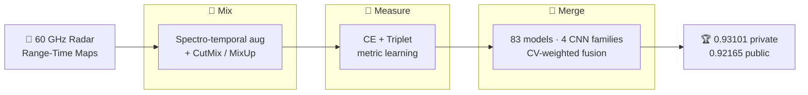

<div align="center">

<a id="top"></a>

# 🥇 Mix, Measure, Merge

### 1st Place 🏆 &nbsp;CVPR 2026 Multimodal Sign Language Recognition Challenge — Track 2

<p>
<em>AI4Good at SignEval 2026: Mix, Measure, Merge with Spectro-Temporal Augmentation<br/>
and Multi-Model Fusion for Isolated Radar-Based Italian Sign Language Recognition</em>
</p>

<p>
<a href="https://www.kaggle.com/competitions/cvpr-mslr-2026-track-2"></a>


<a href="https://huggingface.co/CristianLazoQuispe/CVPR-SignEval2026-models"></a>
<a href="LICENSE"></a>
</p>

**Top-1 on _both_ the public and private Kaggle leaderboards.**

</div>

---

## ✨ Overview

Official code for our **1st-place** solution and paper. The task: Isolated Sign Language Recognition
(ISLR) from **60 GHz FMCW radar Range-Time Maps (RTMs)** over **126 Italian Sign Language (LIS)
classes** — 100 medical words + 26 fingerspelled letters. Radar is a **privacy-preserving,
lighting-invariant** alternative to camera-based recognition.

Our method, **Mix, Measure, Merge**, has three pillars:

| | Pillar | What it does | Impact |
|:--:|:--|:--|:--|
| 🎨 | **Mix** | Spectro-temporal augmentation; CutMix on radar RTMs | **+2.95 pp** (winner of 310+ ablations) |
| 📏 | **Measure** | Triplet + cross-entropy metric learning | Fine-grained separation of look-alike signs |
| 🔀 | **Merge** | CV-weighted fusion of **83 models** / 4 CNN families | Architecture diversity > single-family tuning |



> **🏆 Headline — S23 super-ensemble: `0.93101` private / `0.92165` public, 1st place.**
> 17 configs × 5 folds across 4 CNN families / 5 backbone variants (EfficientNet-B1/B2, ConvNeXt-tiny,
> MobileOne-S2, RegNetY-008), combined by CV-weighted probability averaging.

---

## 📑 Table of Contents

- [⚙️ Setup](#-setup)
- [📦 Data](#-data)
- [🗂️ Repository layout](#-repository-layout)
- [🚀 Quickstart](#-quickstart)
- [🤗 Pretrained models](#-pretrained-models)
- [🏆 Reproduce the winning ensemble](#-reproduce-the-winning-ensemble)
- [📈 Results](#-results)
- [🔬 Reproducibility](#-reproducibility)
- [📄 Citation](#-citation)
- [⚖️ License](#-license)

---

<a id="-setup"></a>

## ⚙️ Setup

```bash
pip install -r requirements.txt
cp .env.example .env          # set DATA_ROOT (required); KAGGLE / WANDB keys (optional)
```

`DATA_ROOT` points to where raw data and experiment outputs live — **outside the repo** (checkpoints,
results, HDF5). Nothing heavy is committed here.

---

<a id="-data"></a>

## 📦 Data

```bash
# Download the challenge data into $DATA_ROOT/raw/{train,test}
python codes/download_data.py

# Convert raw clips to an HDF5 store for fast, parallel training
python codes/convert_to_hdf5.py --input_dir $DATA_ROOT/raw/train --output $DATA_ROOT/data/train.h5
```

```
$DATA_ROOT/
├── raw/{train,test}/      # raw Range-Time Maps per class
├── data/train.h5          # HDF5 store (built above)
└── experiments/           # training outputs — auto-created
```

📊 **Dataset:** 14,742 train / 9,828 test clips · 126 classes · 5-fold stratified CV.

---

<a id="-repository-layout"></a>

## 🗂️ Repository layout

```
codes/final/   train.py · inference.py · ensemble.py · join_submission_val_test.py · …
codes/         download_data.py · convert_to_hdf5.py · submit.py    (data + Kaggle utilities)
src/           data · models · losses · transforms · training_utils.py  (shared, deterministic)
configs/       round9 round12 round13 round14 round15  (final ensemble)  ·  ablation/  (paper)
scripts/       run_queue.py  (multi-GPU batch launcher)  ·  build_s23.sh  (one-shot S23 builder)
```

---

<a id="-quickstart"></a>

## 🚀 Quickstart

A small, easy-to-run ensemble — **5 configs × 5 folds** (EfficientNet-B1 + ConvNeXt).

```bash
# 1) Train (multi-GPU queue; auto-skips finished experiments)
python scripts/run_queue.py --gpus 0,1,2,3 \
  --configs configs/round9/r9_final --script codes/final/train.py \
  --include 'r9_both_trip,r9_cutmix_ls02,r9_cutmix_p08,r9_cutmix_a20,r9_cnxt_trip'
```

<details>
<summary><b>2) Inference → ensemble → submit</b> (click to expand)</summary>

```bash
EXP="$DATA_ROOT/experiments"
CFGS="r9_both_trip r9_cutmix_ls02 r9_cutmix_p08 r9_cutmix_a20 r9_cnxt_trip"

# VAL + TEST inference per config
for cfg in $CFGS; do
  python codes/final/inference.py --config configs/round9/r9_final/$cfg.yaml --device cuda:0
  mv $EXP/$cfg/submission_prob.csv $EXP/$cfg/submission_prob_val.csv
  python codes/final/inference.py --config configs/round9/r9_final/$cfg.yaml --device cuda:0 \
    --test-dir $DATA_ROOT/raw/test
  mv $EXP/$cfg/submission_prob.csv $EXP/$cfg/submission_prob_test.csv
done

# CV-weighted ensemble (VAL + TEST), then join into one submission
python codes/final/ensemble.py --weights-by-cv -o r9_val \
  --probs $EXP/{r9_both_trip,r9_cutmix_ls02,r9_cutmix_p08,r9_cutmix_a20,r9_cnxt_trip}/submission_prob_val.csv
python codes/final/ensemble.py --weights-by-cv -o r9_test \
  --probs $EXP/{r9_both_trip,r9_cutmix_ls02,r9_cutmix_p08,r9_cutmix_a20,r9_cnxt_trip}/submission_prob_test.csv
python codes/final/join_submission_val_test.py \
  --val $EXP/r9_val/submission.csv --test $EXP/r9_test/submission.csv -o $EXP/r9_final/submission.csv

# Submit to Kaggle
python codes/submit.py --csv $EXP/r9_final/submission.csv -m "Round 9 simple ensemble"
```

</details>

---

<a id="-pretrained-models"></a>

## 🤗 Pretrained models

Don't want to retrain? All **83 S23 checkpoints** (17 configs × folds) are on the Hugging Face Hub,
laid out exactly as the pipeline expects — `<config>/fold<k>/best.pt`.

<p>
<a href="https://huggingface.co/CristianLazoQuispe/CVPR-SignEval2026-models"></a>
</p>

```bash
# Pull every checkpoint straight into $DATA_ROOT/experiments (resumable, ~2.9 GB)
pip install -U "huggingface_hub[hf_transfer]"
HF_HUB_ENABLE_HF_TRANSFER=1 hf download CristianLazoQuispe/CVPR-SignEval2026-models \
  --repo-type model --local-dir "$DATA_ROOT/experiments"
```

<details>
<summary><b>Python: download once, then build S23</b> (click to expand)</summary>

```python
import os
from huggingface_hub import snapshot_download

snapshot_download(
    repo_id="CristianLazoQuispe/CVPR-SignEval2026-models",
    repo_type="model",
    local_dir=os.path.join(os.environ["DATA_ROOT"], "experiments"),
)
# Then run inference + CV-weighted fusion:  bash scripts/build_s23.sh --gpu 0
```

</details>

> Each file is a plain PyTorch `state_dict` (`torch.save`); the matching architecture / preprocessing
> for every config lives in its committed `config.yaml`.

---

<a id="-reproduce-the-winning-ensemble"></a>

## 🏆 Reproduce the winning ensemble

The S23 submission. Train all 17 configs (5 folds each), then run the **one-shot builder** — or
skip training entirely and pull the checkpoints from [🤗 Hugging Face](#-pretrained-models).

```bash
# Train every config in the final rounds
for round in round9/r9_final round12 round13 round14 round15; do
  python scripts/run_queue.py --gpus 0,1,2,3 --configs configs/$round --script codes/final/train.py
done

# Build S23: symlinks → inference (VAL+TEST) → CV-weighted ensemble → join → (optional) submit
bash scripts/build_s23.sh --gpu 0        # --submit to push to Kaggle · --dry-run to preview
```

`build_s23.sh` reads `DATA_ROOT` (env or `.env`) and resolves the repo root automatically.

<details>
<summary><b>S23 composition — 17 configs, 4 CNN families / 5 backbones</b> (click to expand)</summary>

| Backbone | Configs |
|:--|:--|
| EfficientNet-B1 | `r9_both_trip` · `r9_cutmix_ls02` · `r9_cutmix_p08` · `r9_cutmix_a20` · `r12_01`…`r12_05` · `r15_b1_s43` |
| EfficientNet-B2 | `r15_b2_cm_trip` |
| ConvNeXt-tiny | `r9_cnxt_trip` · `r15_cnxt_cm` |
| MobileOne-S2 | `r13_mobileone` · `r14_mob_cm2_trip` |
| RegNetY-008 | `r13_regnety` · `r15_regy_cm` |

17 configs × 5 folds = up to 85 fold-models; the official S23 used **83** (one config contributed 3/5
folds). Combined by CV-weighted softmax averaging of per-model probabilities.

</details>

---

<a id="-results"></a>

## 📈 Results

Ensemble scaling — architecture diversity drives the gains (Kaggle **private** LB):

| Submission | Configs | Models | Architectures | Private LB |
|:--|:--:|:--:|:--:|:--:|
| S15 | 6 | 30 | 1 | 0.92612 |
| S16 | 4 | 20 | 1 | 0.92816 |
| S17 | 9 | 45 | 1 | 0.92897 |
| S22 | 15 | 75 | 4 | 0.93019 |
| **🥇 S23** | **17** | **83** | **5** | **0.93101** |

> Final S23 → **0.93101 private / 0.92165 public**, +0.94 pp public→private (robust generalization).

---

<a id="-reproducibility"></a>

## 🔬 Reproducibility

- **Deterministic by default:** `seed: 42`, `deterministic: true`, `amp: false` → bit-identical runs.
- Shared seeding / scheduler / worker-init utilities in `src/training_utils.py`.
- Every experiment is fully defined by its config YAML + the training script.

```bash
python codes/final/validate_reproducibility.py --config configs/round9/r9_final/r9_both_trip.yaml
```

---

<a id="-citation"></a>

## 📄 Citation

```bibtex
@InProceedings{Quispe_2026_CVPR,
    author    = {Quispe, Cristian Lazo and Bejarano, Gissella},
    title     = {AI4Good at SignEval 2026: Mix, Measure, Merge with Spectro-Temporal Augmentation and Multi-Model Fusion for Isolated Radar-Based Italian Sign Language Recognition},
    booktitle = {Proceedings of the IEEE/CVF Conference on Computer Vision and Pattern Recognition (CVPR) Workshops},
    month     = {June},
    year      = {2026},
    pages     = {10528-10537}
}
```

---

<a id="-license"></a>

## ⚖️ License

Released under the [MIT License](LICENSE) © 2026 Cristian Lazo Quispe and Gissella Bejarano.

<div align="center"><sub><a href="#top">⬆ back to top</a></sub></div>
