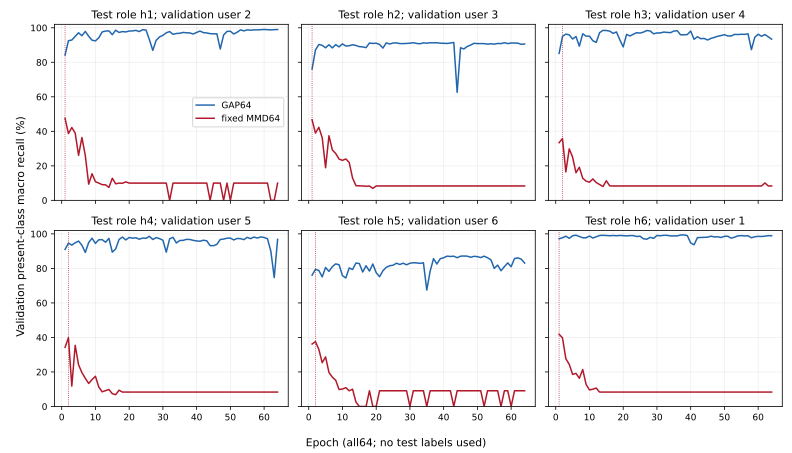
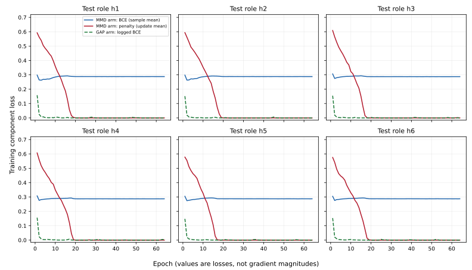

# Closed MMD failure diagnosis: v1

## 2026-11-06：已关闭MMD固定六折退化诊断完成；无重训/调参，VREx唯一原阶段继续

按用户新要求先核对最新d8c39573efb8bef0d4e3c3df11770b91cee3e726、原始日志/检查点及真实进程：原VRExphase64529/start21331595、boot ad409b48-89ce-4704-beee-3658103d5856仍活跃，此处观察held1/train epoch63/4662updates，累计wall2699.166323/CPU2701.175721秒，12h/RSS12GiB固定不改。此次诊断没有启动训练、重复controller、测试配对或新自动任务。MMD完整6均值40.6258% vs原GAP93.6672%、-53.0414pp/0胜的固定配置仍失败关闭，原单折once未调用、旧失败不追改。

分析既有全部producer步骤损失、64轮验证曲线、原GAP同折曲线和严格训练角色的源用户/类别支持。六折末轮训练BCE均0.28748–0.28778，接近仅训练类别先验的常量预测BCE理论最优0.28620–0.28659；末轮对应验证present-macro降至8.3333%/9.0909%/10%，全部只在前1/2轮选中验证最优。分类学习退化在训练/验证即已出现，不是根据测试分数选出解释。报告明确末轮差模型不是替换已选中模型重新算测试分数。

原日志未存分项梯度norm，不能假装恢复了64轮梯度轨迹。另作均匀覆盖全部6折initial/validation-selected/final64共18个只读探针，每次固定该折epoch1原首批64个训练样本，native完整forward/preheadhook，绝无optimizer.step、held标签/预测载入或参数选择。新鲜native初始化seed固定dropout实现，仅initial探针精确重现原首步loss/logits/ID顺序；selected/final探针是同mask的事后采样，不是假称历史下一个batch。选中模型MMD/BCE骨干梯度norm比5.907–11.231，cosine -0.0137至-0.0962，多为不同方向/轻微负向；支持项间尺度失衡的解释，不证明每步都被MMD支配，也不把rawgradient等同AdamWLookahead真实参数更新。MMD无直接headgradient，18探针总norm均未触发clip2，故没有证据把这些点归因“裁剪压制分类头”。

同一固定训练批次的pool特征坐标平均方差，从initial约0.0166–0.0178降为final64的0–1.16e-8（多折约1e-12），与MMD接近零、分类BCE接近先验、验证召回率接近单类输出一致，构成晚期表征趋常量的直接采样证据。常量表征可令MMD归零；这支持边缘对齐趋退化解的可能机制，尚未全训练集特征检查/因果消融，不能直接宣称唯一原因。nativehead含dropout0.2，训练态预测计数可在pool常量时因dropout变化，探针小批准确率不冒充全训练/验证/测试准确率。

源训练类别先验确有差异：u2缺0-based10/11、u6缺3，不同fold训练源分布最大TV为0.0833、0.1667或0.1818；无条件MMD可混入类别先验/小batch采样差异，原生全局BCE按B×12二元输出平均，与作者CE分类槽尺度也不同。这些是有依据的潜在因素，不是已验证的因果归因或调gamma/带宽的理由。七核biasedselfterms数学对角项7(1/n_a+1/n_b)在本批约0.886–1.007是零梯度常量（float32近似），loss值大不能单独证明梯度大；分项梯度另测，不混淆。

独立实现核查不只精确重放：18个BCE与稳定softplus/onehot公式差<2e-7；真实固定DomainBed作者AST核项与生产float32逐位一致；独立float64显式向量差Gaussian值/导数，并与另一解析导数核对，生产特征梯度相对L2误差最大0.0006922（0.06922%），值差最大0.0013721，非bitwise相等。原日志近零负MMD最低约-1.43e-6，与浮点抵消现象一致，但浮点差异对64轮轨迹影响未做因果检验，不因数值小就排除。此举缩小采样BCE/MMD代数/分组/feature提取错误范围，不能排除全部共同实现/预处理/协议错误；freshreplay只证明确定性与恢复，绝不能单独作为无共同bug的证明。

新诊断RESULT/COMPACT/PROBE_CONTEXT保留全部训练/验证曲线、类别supports、18个梯度几何/独立误差、原模型/日志hash；标准matplotlib生成可独立导出SVG/PDF曲线，图不含测试分数。成功只读诊断wall19.236876/CPU19.234915秒、RSS703992KiB。首次只读实现因MMDhead梯度全None的空sum整数触发sqrt类型错误，原源码/错误日志留存，修为显式float64零累加器后有界重跑一次；该中断尝试CPU未记录，不抹去，非额外训练/科学方法bug。原MMD30/原held1的21/运行VREx37/旧VREx22科学文件逐一SHA不变，原检查点和日志复核未变。

继续唯一已冻结VREx完整6生产64+各自独立fresh64/native审计，主12h资源约束不变；全6模型/预测/审计完整私有raw回读及精确release后再唯一cohort评分。若有效，按已在MMD评分前固定的等域BCE+同reset/no-variance联合六折对照分析归因，不能直接把任何提升归给variance或创新。此次解释不改VREx超参/角色/输入/seed/验证选模，用户7–8未用于选择，全部历史8人开发仍探索性，非独立新用户/已验证原创。自动任务频率/启用、云环境/私有Drive/仓库可见性与原789不变，目标未达，VREx当前无新测试分数。

# Closed MMD LOSO6: read-only failure diagnosis

The exact fixed MMD configuration remains failed and closed: the already published six-user mean is40.6258% versus GAP93.6672% (−53.0414pp,0/6 improvements). This report explains existing training behavior. It does not retrain, retune, reopen the configuration, recompute test scores, or change the ongoing frozen VREx experiment. All six roles are considered uniformly; no held user's performance selects the diagnostic states or batches. Historical development remains exploratory.

Evidence consists of every producer step/64 validation epochs per fold, the original GAP validation logs, training-only source/class counts, and18 new read-only gradient probes: initial, validation-selected and epoch64 models, each on that fold's original first shuffled training batch64. Original logs **did not record component gradient norms**. The probes therefore provide sampled post-hoc evidence; they are not a recovered64-epoch gradient trace or a causal ablation. No optimizer object is stepped and no original state is saved over. The models use native training-mode head dropout0.2 with a fixed fresh-initialization RNG realization at each probe; only the initial-state probes reproduce the exact historical first update. The later probes do not restore historical next-update dropout masks. Actual IDs, arrays and model weights are not published.

| Held role | Validation-selected epoch | Selected validation macro | Epoch64 validation macro | Epoch64 train BCE | Constant class-marginal BCE optimum | Selected backbone gradient norm MMD/BCE | Cosine(MMD,BCE) | Epoch64 feature variance on fixed train batch |
|---|---:|---:|---:|---:|---:|---:|---:|---:|
|1|1|47.5000%|10.0000%|0.287757|0.286593|6.676×|-0.04170|1.157e-08|
|2|1|46.6667%|8.3333%|0.287781|0.286593|5.907×|-0.05623|8.234e-12|
|3|2|35.8333%|8.3333%|0.287478|0.286202|9.969×|-0.07839|3.727e-12|
|4|2|39.8333%|8.3333%|0.287511|0.286202|11.231×|-0.09619|3.470e-12|
|5|2|37.5455%|9.0909%|0.287635|0.286381|8.661×|-0.04350|1.899e-11|
|6|1|41.8333%|8.3333%|0.287641|0.286381|8.197×|-0.01374|0.000e+00|

Training and validation already show severe deterioration. In every fold, training BCE settles at0.28748–0.28778, close to the best sample-independent class-prior BCE0.28620–0.28659 calculated solely from that fold's training-label marginals. The formula is mean over12 outputs of binary entropy H(p_k); it is a theoretical constant-output reference, not a newly fitted classifier. Epoch64 validation macro is1 divided by the number of present validation classes (8.3333%,9.0909% or10%). The saved validation-selected models occur at epochs1/2 with35.8333%–47.5000% validation recall; the quoted poor epoch64 models are **not** substituted for the selected models in the published test result. GAP's recorded training BCE falls much further, while its validation curve is substantially stronger under the same subject roles.

The fixed training-batch pooled-feature mean per-coordinate variance falls from approximately0.0166–0.0178 at initialization to0–1.16e−8 at epoch64 (several folds around1e−12). This is direct sampled evidence of a nearly constant representation late in training. A constant representation makes all source distributions coincide and Gaussian MMD zero. Combined with near-class-prior BCE and the falling total objective, this supports an alignment-dominated, degenerate solution as a plausible mechanism. It does not demonstrate that every training sample has the same feature, or that one isolated cause explains the selected models' complete generalization gap. Native head dropout can yield varying training-mode predicted labels even when the pre-head pooled features are constant; those first-batch prediction counts are not validation/test accuracy or full-training accuracy.

The first epoch's mean MMD value is0.575–0.609 and its sample-weighted BCE0.298–0.308. Those means have explicitly different aggregation conventions: MMD is the mean over updates, BCE is sample weighted; their sum is not presented as an exact epoch loss. Both raw per-step values and update-mean total loss are preserved in RESULT.json. Large loss values alone do not prove large gradients. For the biased seven-kernel estimator, the exact-arithmetic diagonal contribution averaged over group pairs is7(1/n_a+1/n_b), here about0.886–1.007 in these first batches. That mathematical diagonal term is constant and has zero gradient; off-diagonal/cross terms can cancel it. Floating-point norm/dot distance cancellation makes the actual float32 diagonal only approximately constant. Loss value ratios must not be mistaken for gradient ratios.

The separate probes show initial backbone MMD/BCE gradient norm ratios3.650–5.364 and selected-model ratios5.907–11.231. At selected states their cosines are−0.0137 to−0.0962: primarily different directions with mild negative alignment, not an assertion of universally antiparallel gradients. MMD has zero direct classifier-head gradient. The combined whole-parameter norm stays below the clip2 threshold in **all18 sampled probes**, so their clip coefficient is1; these data do not support a claim that clipping suppressed the classifier head at those states. They do not establish whether clipping occurred at other historical updates. Raw component gradients also do not equal AdamW+Lookahead parameter contributions because the optimizer is adaptive and stateful. Late probes vary across folds: some MMD gradients are nearly zero, one has a very large relative backbone ratio only because its BCE backbone gradient has almost vanished. A single constant 'MMD dominated every update' claim would be unsupported.

All source-user training distributions have unequal class marginals: user2 lacks classes10/11 and user6 lacks3 (0-based). The maximum pairwise class-marginal total variation within the training set is0.0833 for held1/2,0.1818 for held3/4, and0.1667 for held5/6. Present classes have100 records per user; aggregate training supports and the actual first-batch class counts are preserved. The algorithm aligns unconditional source feature distributions without class conditioning, so class-marginal differences and random within-batch class composition can introduce pressure unrelated to class-preserving alignment. This is a plausible contributing factor, **not a tested causal attribution**. The complete pooled BCE averages over batch×12 binary outputs, whereas the pinned author's classification slot is multiclass cross entropy; the unchanged coefficient1 transfers across different loss scales. That is a documented recipe adaptation, not proof of which parameter would rescue performance. No weight/kernel/seed search is performed or proposed as a reinterpretation of the closed result.

Independent checks and their limits:

- All six initial probes exactly match the saved real first-update logits, classification loss, MMD loss and training-ID/order hashes, using the full native forward and a classifier pre-hook. No held inputs or labels are used in these probes.
- All18 BCE values agree with an independently written stable softplus/onehot formula within2e−7. The actual pinned DomainBed AbstractMMD class extracted from the committed author AST gives exactly the production MMD value at all18 feature sets.
- An independent float64 implementation uses explicit pairwise differences rather than the production norm/dot trick. Its autograd derivative agrees with a separate analytic Gaussian derivative. Relative L2 error between this feature gradient and production float32 is at most0.0006922 (0.06922%); the maximum MMD value difference is0.0013721. Agreement is numerical, **not bitwise**. Small negative production MMD values around−1.43e−6 occur in the logs although the exact Gaussian biased squared discrepancy is nonnegative; they are consistent with observed cancellation near zero. The effect of float32 differences on the entire64-epoch trajectory was not separately tested and is not dismissed causally.
- These checks narrow errors in the sampled BCE/MMD algebra, grouping and feature extraction. They do not independently verify every backbone derivative, batch, preprocessing assumption or full trajectory. Fresh replay proves deterministic reproduction and state restoration; it cannot by itself rule out a shared implementation error. No blanket 'all implementation errors excluded' conclusion is made.

RESULT.json retains all64 curves, full training class supports, step-value summaries,18 gradient geometries, independent discrepancies and source/checkpoint hashes. All original checkpoints/logs and MMD scientific sources were checked byte-identical after analysis. The successful diagnostic pass cost19.236876wall/19.234915CPU seconds, maxRSS703992KiB. A prior incomplete read-only attempt failed when an unused MMD head-gradient group summed to a Python integer; it was preserved and fixed with an explicit float64 zero accumulator, with one bounded diagnostic rerun. Its separate CPU cost was not recorded. It involved no optimizer updates or held labels and changed no scientific implementation. DIAGNOSTIC_REPAIR.json and ATTEMPT1_STDOUT.log retain the incident; it is not an additional training experiment.

The frozen VREx sixfold process continues under its original twelve-hour cumulative wall/CPU cap, with no duplicate launcher or changes from this diagnosis. A positive full-cohort result must first satisfy its previously fixed gate and then use the already planned matched equal-domain-BCE+reset/no-variance sixfold control before attributing benefit to variance. No test fold is used to select or alter this route, and no originality claim follows from this explanatory report.
